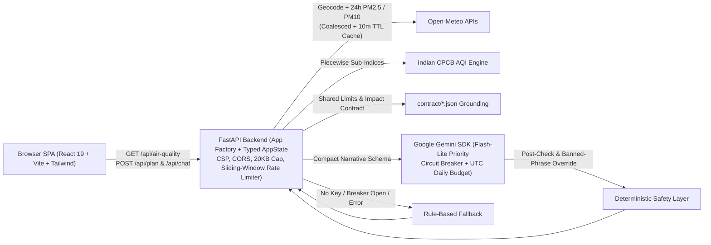

# Saans — Urban Air Quality Assistant

[](https://github.com/Shreyash463/saans-urban-air-quality-assistant/actions/workflows/ci.yml)
[](https://github.com/Shreyash463/saans-urban-air-quality-assistant/actions/workflows/codeql.yml)

**Live Demo**: <https://saans-urban-air-quality-assistant.onrender.com> · **Deploy**: [Render Blueprint](https://render.com/deploy?repo=https://github.com/Shreyash463/saans-urban-air-quality-assistant) · **Branch**: `main`

**Saans** (_"breath"_ in Hindi) is a bilingual (**English + हिन्दी**) web application helping Indian households and communities navigate severe winter smog and urban air pollution. It combines a React 19 + TypeScript + Tailwind SPA with a FastAPI + Google Gemini backend, live Open-Meteo particulate data mapped to the **Indian CPCB AQI scale**, deterministic safety guardrails, and an interactive multiplicative Impact Simulator.

## Challenge Mapping (Problem Statement -> Code)

| Requirement                       | Implementation                                                                                                                                      | Key Files                                                                                                                                             |
| --------------------------------- | --------------------------------------------------------------------------------------------------------------------------------------------------- | ----------------------------------------------------------------------------------------------------------------------------------------------------- |
| **Winter smog & CPCB AQI**        | Live Open-Meteo 24h PM2.5/PM10 mapped to Indian CPCB bands (`0–500`) with deterministic health & fitted N95/FFP2 guidance.                          | [`cpcb.py`](backend/app/services/cpcb.py), [`safety.py`](backend/app/services/safety.py), [`AqiGauge.tsx`](frontend/src/components/AqiGauge.tsx)      |
| **Families & communities**        | Vulnerability flags (`children`, `elderly`, `respiratory`), **"Make it a community effort"** cards (RWA/school/workplace/neighbours), and 10–500 scale. | [`CommunityActionsSection.tsx`](frontend/src/components/CommunityActionsSection.tsx), [`Simulator.tsx`](frontend/src/sections/Simulator.tsx)          |
| **Location & lifestyle**          | Household form (`city`, commute, purifier, fuel, budget, EN/HI) + opt-in geolocation (`POST` body coords only, zero storage/logs).                 | [`ProfileForm.tsx`](frontend/src/sections/ProfileForm.tsx), [`air_quality.py`](backend/app/routers/air_quality.py)                                    |
| **Low-emission daily routine**    | Coherent 4-slot daily schedule accounting for 6–10 AM/PM winter inversions and the 1–4 PM cross-ventilation window.                                 | [`prompts.py`](backend/app/prompts.py), [`DashboardPlanCards.tsx`](frontend/src/components/DashboardPlanCards.tsx)                                    |
| **Indoor air quality hacks**      | Budget-ranked Indian actions (wet mopping, skipping incense/coils, EPDM sealing, DIY box-fan + HEPA, debunking plant myths).                        | [`gemini/client.py`](backend/app/services/gemini/client.py), [`DashboardPlanCards.tsx`](frontend/src/components/DashboardPlanCards.tsx)               |
| **Swaps & direct impact math**    | Shared [`impact-factors.json`](contract/impact-factors.json) caps (`0–95%` PM2.5, `0` CO2 on non-emission actions) & interactive Impact Simulator. | [`impact.py`](backend/app/services/impact.py), [`impact.ts`](frontend/src/lib/impact.ts)                                                              |
| **Grounded Ask Saans chat**       | Active plan/AQI chat with prompt-injection & secret-leak guards, emergency `108` escalation, and deterministic rule fallback.                       | [`chat.py`](backend/app/routers/chat.py), [`Chat.tsx`](frontend/src/sections/Chat.tsx)                                                                |

## Architecture



For full request sequence diagrams and design rationales, see [`docs/ARCHITECTURE.md`](docs/ARCHITECTURE.md) and [`docs/DECISIONS.md`](docs/DECISIONS.md).

## Quick Start (3 Commands)

```bash
# 1. Build frontend production bundle (frontend/dist/)
cd frontend && npm ci --ignore-scripts && npm run build && cd ..

# 2. Create virtual environment and install hash-pinned backend dependencies
python -m venv .venv && .venv/Scripts/pip install --require-hashes -r backend/requirements-dev.txt  # Linux/macOS: .venv/bin/pip

# 3. Configure environment and start single-origin FastAPI + SPA server
cp .env.example .env && .venv/Scripts/python -m uvicorn --factory --app-dir backend app.main:create_app --host 0.0.0.0 --port 8000
```

For Vite HMR frontend development alongside FastAPI (`:8000`), run `cd frontend && npm run dev` in a second terminal. Leave `GEMINI_API_KEY` unset to run deterministically offline (`generatedBy: "rules"`).

## Verification & Quality Gates

| Layer            | Command (inside `frontend/` or `backend/`)                             | Current Status                                                |
| ---------------- | ---------------------------------------------------------------------- | ------------------------------------------------------------- |
| **Frontend CI**  | `npm run format:check && npm run lint && npm run test:coverage`        | **76** Vitest tests (**97.60%** line coverage), **0** dup/unused |
| **Bundle Build** | `npm run build && npm audit --omit=dev`                                | `index-*.js`: **`292.21 kB`** (`91.16 kB` gzip), **0** vulns  |
| **Playwright**   | `npm run test:e2e`                                                     | **8** E2E workflows (EN/HI, geolocation, 429/503, `axe-core`) |
| **Backend CI**   | `ruff check app tests scripts && mypy app && pytest --cov=app --cov-branch` | **215** offline tests (**95.36%** line+branch coverage)      |
| **Contract**     | `python scripts/export_contract.py --check`                            | Schema, OpenAPI & TypeScript types synchronized               |

## Documentation & Cloud Deploy

- **One-Click Cloud Deploy**: [](https://render.com/deploy?repo=https://github.com/Shreyash463/saans-urban-air-quality-assistant) — builds [`Dockerfile`](Dockerfile) via [`render.yaml`](render.yaml).
- **API & Contract**: [`docs/API.md`](docs/API.md) · [`docs/openapi.json`](docs/openapi.json)
- **Performance & Benchmarks**: [`docs/PERFORMANCE.md`](docs/PERFORMANCE.md) · [`backend/scripts/bench.py`](backend/scripts/bench.py)
- **Deployment & Env Vars**: [`docs/DEPLOYMENT.md`](docs/DEPLOYMENT.md)
- **Security & Threat Model**: [`SECURITY.md`](SECURITY.md) · [`docs/THREAT_MODEL.md`](docs/THREAT_MODEL.md)
- **Testing & Accessibility**: [`docs/TESTING.md`](docs/TESTING.md) · [`docs/ACCESSIBILITY.md`](docs/ACCESSIBILITY.md)
- **Safety Limitations**: Open-Meteo provides PM2.5/PM10 modeled estimates (not gaseous O3/NO2/SO2/CO). Saans is not medical advice; emergency symptoms direct users to `108` / emergency care.

[MIT License](LICENSE)
