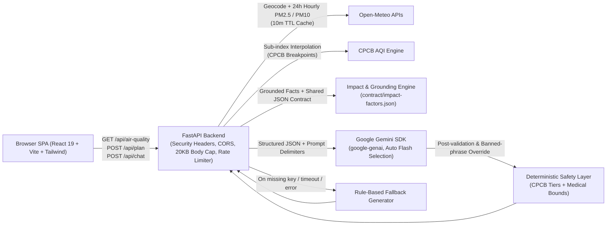

# Saans — Urban Air Quality Assistant

[](https://github.com/Shreyash463/saans-urban-air-quality-assistant/actions/workflows/ci.yml)

**Saans** (Hindi for *"breath"*) is a bilingual (**English + हिन्दी**) full-stack web application built to help Indian households and communities navigate severe winter smog and urban air pollution. It combines a React + TypeScript + Vite frontend with a hardened FastAPI + Google Gemini backend, live Open-Meteo particulate data calibrated to the **Indian CPCB National AQI scale**, deterministic safety guardrails, and an interactive multiplicative impact simulator.

- **One-Click Cloud Deploy (Render Free Tier)**: [Deploy to Render](https://render.com/deploy?repo=https://github.com/Shreyash463/saans-urban-air-quality-assistant) (uses [`render.yaml`](render.yaml) + [`Dockerfile`](Dockerfile))

---

## Problem Statement Alignment

> *"Create a GenAI-powered assistant that helps families and communities navigate severe winter smog and urban air pollution. It should suggest low-emission daily routines, indoor air quality hacks, and sustainable alternatives tailored to their location and lifestyle, while clearly explaining the direct impact of their choices."*

| Problem Statement Requirement | Saans Implementation |
| --- | --- |
| **Navigate severe winter smog & urban pollution** | Live Open-Meteo PM2.5/PM10 readings mapped to the Indian CPCB AQI scale (0–500) with color + icon + text indicators, deterministic health advisories, and tiered N95/FFP2 mask guidance. |
| **Tailored to location and lifestyle** | Multi-field household profile capturing city, household size, children/older adults/respiratory vulnerability, commute mode & distance, home type, air purifier ownership, cooking fuel, budget, and language (`en` / `hi`). |
| **Low-emission daily routines** | Coherent 4-slot daily routine (`morning`, `midday`, `evening`, `night`) accounting for winter thermal inversions (6–10 AM, 6–10 PM), the cleaner 1–4 PM cross-ventilation dip, and the user's exact commute and home setup. |
| **Indoor air quality hacks** | 5–7 practical India-context hacks (wet mopping vs dry sweeping, skipping incense/coils, EPDM weather-stripping, DIY box-fan + True HEPA filter, kitchen exhaust, honest plant myth debunking) ranked by budget and purifier ownership. |
| **Sustainable alternatives & direct impact** | Lifestyle swaps paired with bounded PM2.5 reduction (%) and monthly CO2 savings (kg) shown **only** for emission-changing actions, plus an interactive **Impact Simulator** showing BEFORE → AFTER exposure and consistent `score = round(100 - residualExposure)`. |
| **Conversational follow-up** | **Ask Saans** assistant grounded in the active household plan and AQI with prompt-injection defense, medical-emergency escalation, off-topic polite declines, and deterministic fallback. |

---

## Architecture



---

## Features

- **Live + Demo Air Quality**: Fetches 24-hour PM2.5/PM10 observations from Open-Meteo (no external AQ API key required), prefers Indian geocoding matches when ambiguous, computes CPCB sub-indices, caches for 10 minutes, and falls back gracefully to curated Indian city demo readings (`Sample reading`).
- **GenAI Personalization + Grounded Math**: Uses `google-genai` structured JSON output (`temperature: 0.3`, 20s timeout, single retry, automatic newest `flash` model discovery via `models.list()`).
- **Zero Invented Metrics**: Both frontend and backend load numeric constants from `contract/impact-factors.json`. The backend overwrites/clamps LLM numbers (`pm25ReductionPct` capped at `95%`; `co2SavedKgPerMonth` nonzero strictly on emission-changing swaps).
- **Deterministic Safety Layer**: Enforces CPCB tier + vulnerability rules (`children`, `elderly`, `respiratory`). Never allows claims that outdoor exercise is safe for sensitive groups at AQI ≥ 101 or anyone at AQI ≥ 201, blocks diagnostic/dosing language, and escalates emergency symptoms (`chest pain`, `severe breathlessness`, `blue lips`, `fainting`).
- **Habit-Aware Recommendations**: Never recommends purchasing/adopting a habit the household already practices (metro/bus/walk/WFH commute, induction/PNG cooking, existing air purifier); instead acknowledges and optimizes around it.
- **Export & Print**: Print stylesheet (`@media print` single-column black-on-white), **Download plan (.txt)**, and **Copy plan** with `aria-live="polite"` confirmations.
- **Bilingual & Theme-Aware**: Instant English / हिन्दी (`<html lang>`) switching, Light & Dark modes, and full `prefers-reduced-motion` + in-app Reduce Motion toggle.

---

## How Gemini Is Used & How Numbers Are Grounded

1. **Startup Model Selection & Automatic Failover**: If `GEMINI_MODEL` is unset and `GEMINI_API_KEY` is provided in root `.env`, the backend calls `client.aio.models.list()` at startup (with a `3.5s` bounded timeout), filters text `flash` models supporting `generateContent` (excluding TTS/image/omni/live/embedding), ranks newest first (`gemini-3.8-flash` down through `gemini-3.5-flash`, `gemini-3.5-flash-lite`, and `gemini-3.1-flash-lite`), and automatically promotes whichever active model succeeds (`gemini-3.5-flash-lite` / `gemini-3.1-flash-lite` / `gemini-3.6-flash` observed live) if upstream capacity spikes (`503`/`429`) occur.
2. **Grounding Before Generation**: `backend/app/services/impact.py` computes household `ProfileFacts` (already-followed habits, vulnerability flags, budget rank, and deterministic swap baselines from [`contract/impact-factors.json`](contract/impact-factors.json)).
3. **Low-Latency Structured Generation**: Gemini writes tailored English or Hindi guidance using `_SIMPLE_PLAN_JSON_SCHEMA` (`response_mime_type="application/json"`, `temperature=0.3`, lowest-latency `ThinkingConfig` per model generation).
4. **Post-Generation Enforcement**: `ground_alternatives_numbers()` replaces/clamps all numeric savings against `contract/impact-factors.json` (`0–95%` PM2.5, `0` CO2 for non-emission actions like masks/windows/purifiers/sealing), and `enforce_plan_safety()` validates `healthAdvisory` and `maskGuidance` against deterministic CPCB rules (e.g., never permitting outdoor exercise for vulnerable households at AQI ≥ 101 or anyone at AQI ≥ 201).
5. **Resilient Fallback**: When `GEMINI_API_KEY` is missing or Gemini fails/times out/hits quota, `services/fallback_plan.py` produces a complete personalized plan tagged `generatedBy: "rules"`.

---

## Safety Design & Known Limitations

- **PM-Based CPCB Estimate**: Open-Meteo air quality readings reflect modeled hourly PM2.5 and PM10 concentrations (averaged over the past 24 observed hours with at least 12 valid hours required), not ground-station gaseous pollutants (O3, NO2, SO2, CO) or local street-canyon spikes.
- **Not Medical Advice**: Saans provides general environmental and low-emission household guidance. Every plan and symptom response reminds users to consult a qualified physician, and severe symptoms prompt immediate emergency care (`108` / nearest ER).
- **Approximate Household Estimates**: Simulator PM2.5 (%) and monthly CO2 (kg) estimates are planning approximations derived from `contract/impact-factors.json`, not clinical or laboratory measurements.

---

## Setup (3 Commands)

```bash
# 1. Install frontend dependencies and build production bundle
npm ci && npm run build

# 2. Set up Python environment and install backend dependencies
python -m venv .venv && .venv/Scripts/pip install -r backend/requirements-dev.txt  # Linux/macOS: .venv/bin/pip

# 3. Configure environment and launch single-origin server (serves UI + /api)
cp .env.example .env && .venv/Scripts/python -m uvicorn --app-dir backend app.main:app --host 0.0.0.0 --port 8000
```

For local Vite HMR frontend development alongside FastAPI (`http://localhost:8000`):

```bash
npm run dev   # proxies /api -> http://127.0.0.1:8000
```

---

## Environment Variables

See [`.env.example`](.env.example):

| Variable | Default | Purpose |
| --- | --- | --- |
| `ENVIRONMENT` | `production` | `production` disables `/docs`, `/redoc`, and `/openapi.json` (set `development` locally to browse docs). |
| `GEMINI_API_KEY` | *(unset)* | Server-side Google Gemini API key read from root `.env`. Missing/invalid keys automatically use rule-based fallback. |
| `GEMINI_MODEL` | *(auto)* | Optional model ID override (e.g. `gemini-3.8-flash` or `gemini-2.5-flash`). Auto-discovers newest flash model at startup when blank. |
| `ALLOWED_ORIGINS` | `http://localhost:5173,http://localhost:4173` | Comma-separated CORS origin allowlist (never `*`). |
| `TRUST_PROXY_HEADERS` | `false` | Set `true` behind Render/Cloud Run/nginx so rate limiting extracts client IPs safely from the rightmost `trusted_proxy_hops` entry of `X-Forwarded-For`. |
| `TRUSTED_PROXY_HOPS` | `1` | Number of trusted proxy hops to strip from the right of `X-Forwarded-For`. |
| `VITE_API_BASE_URL` | `""` | Frontend API base URL; empty string uses same-origin `/api`. |
| `VITE_USE_MOCK` | `false` | Set `"true"` to run the frontend strictly on the built-in client mock without calling `/api`. |

---

## API Reference

All payloads use camelCase JSON matching [`src/types/index.ts`](src/types/index.ts) and [`backend/app/schemas.py`](backend/app/schemas.py).

### `GET /api/health`
Returns service readiness and active model selection (never exposes secrets).

```json
{
  "status": "ok",
  "geminiConfigured": false,
  "selectedModel": null
}
```

### `GET /api/air-quality?city=Pune`
Returns live Open-Meteo CPCB-calibrated reading (cached 10 minutes) or `"demo"` fallback.

```json
{
  "city": "Pune",
  "aqi": 84,
  "dominantPollutant": "PM2.5",
  "updatedAt": "2026-11-25T12:00:00+05:30",
  "source": "live",
  "sourceDetail": "Open-Meteo, PM-based CPCB estimate"
}
```

### `POST /api/plan`
Request body (`UserProfile`):

```json
{
  "city": "Delhi",
  "householdSize": 4,
  "hasChildren": true,
  "hasElderly": false,
  "hasRespiratoryCondition": true,
  "commuteMode": "car",
  "commuteKm": 18,
  "homeType": "apartment",
  "hasAirPurifier": false,
  "cookingFuel": "lpg",
  "budget": "low",
  "language": "en"
}
```

Response (`PlanResponse`): returns `aqi`, `summary`, `healthAdvisory`, `routine` (4 slots), `indoorHacks` (5–7 items), `alternatives` (3–5 items), `maskGuidance`, `disclaimer`, and `generatedBy` (`"gemini" | "rules"`).

<details>
<summary>Sanitized Real Gemini Example Responses (captured live on <code>gemini-3.5-flash-lite</code> + Open-Meteo)</summary>

**Example 1 — Delhi car commuter, high budget (`AQI 236`, `PM2.5`, `generatedBy: "gemini"`):**

```json
{
  "aqi": {
    "city": "Delhi",
    "aqi": 236,
    "dominantPollutant": "PM2.5",
    "updatedAt": "2026-11-25T16:00:00+05:30",
    "source": "live",
    "sourceDetail": "Open-Meteo, PM-based CPCB estimate"
  },
  "summary": "Welcome to your Delhi clean-air plan. With an AQI of 236, heavy smog and thermal inversions trap pollutants, making targeted indoor and commute defenses essential for your 2-person household.",
  "healthAdvisory": "AQI is 236, which is poor. Avoid all outdoor exertion as trapped winter pollutants and PM2.5 severely irritate airways. Keep sensitive family members indoors and rely on clean indoor air.",
  "routine": [
    {
      "timeSlot": "morning",
      "title": "Morning Inversion Defense",
      "detail": "Keep windows shut tightly during the 6 AM to 10 AM thermal inversion peak to prevent outdoor vehicle and fog smog from entering your independent house.",
      "impactNote": "Blocks heavy morning particulate matter from settling indoors while you prepare your breakfast on LPG."
    }
  ],
  "alternatives": [
    {
      "current": "Daily car commute of 22 km",
      "swap": "Switch to public transit or carpooling for part of your daily 22 km journey",
      "why": "Lowers tailpipe emissions on congested urban roads and reduces personal exposure to traffic fumes.",
      "pm25ReductionPct": 14,
      "co2SavedKgPerMonth": 85
    },
    {
      "current": "No bedroom air purification",
      "swap": "Install a dedicated True HEPA air purifier in your bedroom",
      "why": "Provides clean, particulate-free air during sleep when your respiratory system recovers.",
      "pm25ReductionPct": 42,
      "co2SavedKgPerMonth": 0
    }
  ],
  "maskGuidance": "Wear a fitted N95 or FFP2 respirator mask whenever you step outside during your car commute or errands to filter out toxic PM2.5 particles effectively.",
  "generatedBy": "gemini"
}
```

**Example 2 — Pune family with child & respiratory sensitivity, metro + induction + purifier, low budget (`AQI 58`, `PM2.5`, `generatedBy: "gemini"`):**

```json
{
  "aqi": {
    "city": "Pune",
    "aqi": 58,
    "dominantPollutant": "PM2.5",
    "updatedAt": "2026-11-25T16:00:00+05:30",
    "source": "live",
    "sourceDetail": "Open-Meteo, PM-based CPCB estimate"
  },
  "summary": "Hello from Saans! It is wonderful that your Pune family already uses clean electric induction for cooking, relies on public transport for your 14 km commute, and maintains an indoor air purifier.",
  "healthAdvisory": "With Pune AQI at 58, air quality is satisfactory, but sensitive family members like children and those with asthma require mindful protection during peak traffic hours.",
  "indoorHacks": [
    {
      "title": "Optimize Existing Air Purifier",
      "howTo": "Check and gently vacuum the pre-filter of your purifier to ensure maximum airflow and filtration efficiency.",
      "estimatedBenefit": "Maintains peak CADR performance for your apartment.",
      "costLevel": "free"
    }
  ],
  "alternatives": [
    {
      "current": "Using loose cloth face coverings",
      "swap": "Switching to certified fitted N95 masks",
      "why": "Certified N95 respirators create a proper seal around the nose and mouth to block fine particulate matter effectively.",
      "pm25ReductionPct": 35,
      "co2SavedKgPerMonth": 0
    },
    {
      "current": "Burning garden or household waste outdoors",
      "swap": "Composting organic waste and using municipal disposal for trash",
      "why": "Eliminating open burning prevents heavy localized toxic smoke and harmful carbon emissions.",
      "pm25ReductionPct": 16,
      "co2SavedKgPerMonth": 28
    }
  ],
  "generatedBy": "gemini"
}
```

</details>

### `POST /api/chat`
Request body: `{ "question": "...", "profile": UserProfile, "plan": PlanResponse }`

Response (`ChatReply`):

```json
{
  "answer": "At AQI 310 (Very Poor) in Delhi, outdoor play and exertion should be avoided for everyone..."
}
```

---

## Tests, Linting, Typechecking, and Build

```bash
# Frontend checks
npm run format:check
npm run lint
npm run test:run
npm run build
npm audit --omit=dev

# Backend checks (inside backend/)
ruff check app tests
mypy app
pyright --project pyproject.toml
pytest --cov=app --cov-report=term-missing
pip-audit -r requirements.txt
```

---

## Deployment

### Option 1: Render (60-Second Blueprint Deploy — Free Tier)

[](https://render.com/deploy?repo=https://github.com/Shreyash463/saans-urban-air-quality-assistant)

1. Open `https://render.com/deploy?repo=https://github.com/Shreyash463/saans-urban-air-quality-assistant` and authorize GitHub access for the repository.
2. When prompted by [`render.yaml`](render.yaml), paste your server-side `GEMINI_API_KEY` (leave `GEMINI_MODEL` blank to auto-select the newest Flash model).
3. Click **Deploy Blueprint** — Render builds [`Dockerfile`](Dockerfile), serves the React SPA and FastAPI `/api` on a single HTTPS origin, and monitors `/api/health`.

### Option 2: Google Cloud Run

```bash
gcloud run deploy saans-assistant --source . --region asia-south1 --allow-unauthenticated \
  --set-env-vars ENVIRONMENT=production,TRUST_PROXY_HEADERS=true --set-secrets GEMINI_API_KEY=gemini-api-key:latest
```

### Option 3: Vercel (Frontend) + Hosted FastAPI Backend

Deploy the static Vite SPA to Vercel while pointing `VITE_API_BASE_URL` at your Cloud Run or Render backend URL (adding the Vercel domain to `ALLOWED_ORIGINS` on the backend):

```bash
vercel --prod   # Build command: npm run build | Output dir: dist | Env: VITE_API_BASE_URL=https://<backend-url>
```

### Option 4: Local Docker

Multi-stage build (Node 24 builds frontend → slim Python 3.13 non-root runtime serves static `dist/` + `/api` on `$PORT`, defaulting to `8000`):

```bash
docker build -t saans-assistant .
docker run --rm -p 8000:8000 -e ENVIRONMENT=production --env-file .env saans-assistant
```

---

## Security Notes

- `GEMINI_API_KEY` stays strictly server-side in `.env` (gitignored); never logged or returned in API errors.
- Interactive API docs (`/docs`, `/redoc`, `/openapi.json`) and stack traces are disabled in `ENVIRONMENT=production`.
- Strict Pydantic v2 schemas (`extra="forbid"`, city regex/length `<= 60`, `householdSize` `1–20`, `commuteKm` `0–300`, `question` `<= 500`, control-char stripping).
- Prompt-injection defense: user text is sanitized, angle-brackets escaped, enclosed in `<user_question>...</user_question>` delimiters, and post-checked against secret/prompt leakage and medical rules.
- Sliding-window per-IP rate limiter (`20 req/min` on `/api/plan` and `/api/chat`, `60 req/min` on `/api/air-quality`, returning `429` + `Retry-After`) with trusted-proxy rightmost `X-Forwarded-For` validation to block header spoofing.
- `20 KB` max request body middleware, strict CORS origin allowlist, `X-Content-Type-Options: nosniff`, `X-Frame-Options: DENY`, `Referrer-Policy: no-referrer`, `Permissions-Policy`, HSTS over HTTPS, and strict CSP (`script-src 'self'`).

---

## Accessibility Notes

- Semantic landmarks (`header`, `nav`, `main`, `footer`), sequential heading hierarchy, skip-to-main link, and `aria-current="true"` scroll-spy.
- Polite `aria-live` status announcements for loading stages, plan readiness, clipboard copy, `.txt` export, and chat replies.
- High-contrast focus rings, ≥44px touch targets, color + icon + text CPCB indicators, WCAG AA contrast in Light and Dark modes, clean one-column print layout, full reduced-motion support, and automated `axe-core` verification across all sections.

---

## License

[MIT](LICENSE)
