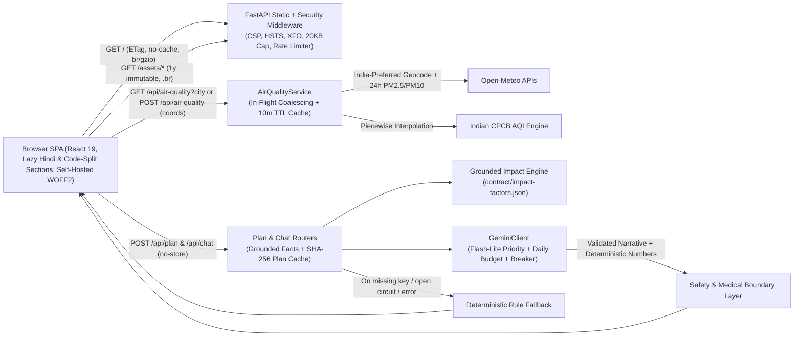
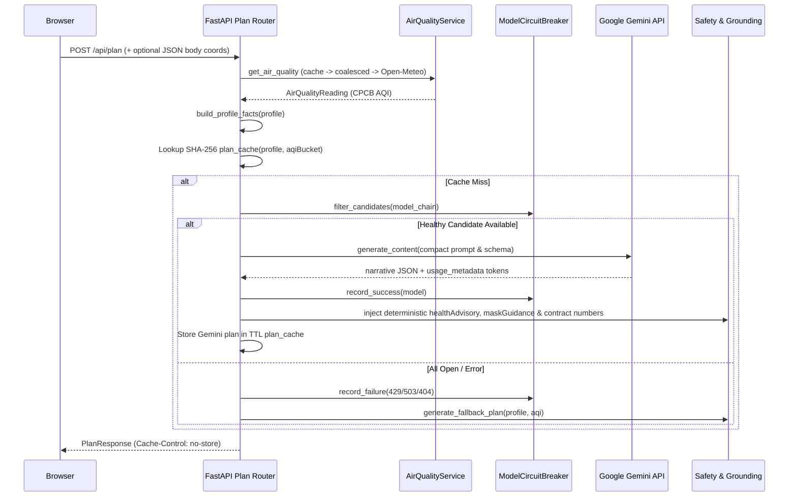

# Saans System Architecture

## Overview

Saans runs as a single-origin containerized web service (FastAPI serving compiled static Vite/React assets plus JSON `/api/*` endpoints).

## Request Lifecycle (`POST /api/plan`)

## Module Boundaries

- **Shared Grounding & Codegen Contract**: [`contract/api.schema.json`](../contract/api.schema.json), [`contract/limits.json`](../contract/limits.json), [`contract/aqi-categories.json`](../contract/aqi-categories.json), [`contract/impact-factors.json`](../contract/impact-factors.json), [`contract/demo-cities.json`](../contract/demo-cities.json), and [`contract/golden-vectors.json`](../contract/golden-vectors.json) act as the single source of truth across FastAPI (`backend/scripts/export_contract.py`) and React TypeScript (`frontend/src/types/generated.ts`, `frontend/src/lib/validation.ts`).
- **Gemini Isolation**: `backend/app/services/gemini/` isolates daily call budgeting (`budget.py`), circuit breaking (`circuit_breaker.py`), model ranking & `ThinkingConfig` (`model_selection.py`), compact output schema (`schema.py`), plan response assembly (`assembler.py`), single-attempt execution (`attempts.py`), and async failover (`client.py`).
- **Single Network Boundary**: All browser `fetch` calls live strictly in `frontend/src/services/api.ts`, with localized copy separated into lazy JSON locales (`frontend/src/locales/en.json`, `frontend/src/locales/hi.json`).
